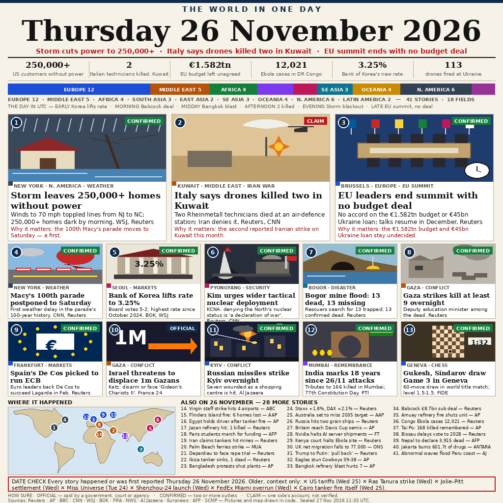

[](https://make.fun/bounty/news-image-20261126?utm_source=github&utm_medium=readme&utm_campaign=news-image-20261126)
[](https://make.fun/bounty/news-image-20261126?utm_source=github&utm_medium=readme&utm_campaign=news-image-20261126)
[](https://make.fun/bounty/news-image-20261126?utm_source=github&utm_medium=readme&utm_campaign=news-image-20261126)

# Elegant Axis — Thursday 26 November 2026

A one-day world news page: **41 stories, 17 fields, 9 regions**, all from
Thursday 26 November 2026. Drawn entirely in code — no photos, no assets,
no network at render time.



## What's on the page

- **3 leads** with a drawn scene, a status chip and a "Why it matters" line:
  the Thanksgiving storm that cut power to 250,000+ homes, Italy saying
  drones killed two technicians in Kuwait, and the EU summit ending with
  no budget deal.
- **10 medium stories** with a drawn scene and a status chip: the Macy's
  100th parade postponed, the Bank of Korea lifting its rate to 3.25%,
  Kim's tactical nuclear call, the Bogor mine flood, Gaza, the ECB pick,
  the 1m-Gazans threat, Kyiv, the 26/11 remembrance and the Geneva chess
  draw.
- **28 more stories** in a three-column index, each with its source.
- **A world map** with numbered pins for all 13 pictured stories.
- **A KPI strip** of six verified numbers, a region bar that sums to 41,
  an hour-by-hour UTC timeline, a DATE CHECK box that names the older
  stories left out, and a HOW SURE legend (OFFICIAL / CONFIRMED / CLAIM).

## How it is made

`draw_r26.py` draws the whole page with Pillow and the DejaVu fonts:

```sh
python3 draw_r26.py   # writes entry.png, 1024x1024, deterministic
```

The press time is fixed in the script, so the render is byte-identical
every run. Sealed 27 Nov 2026 11:59 UTC.

## Facts

Every number on the page was checked against primary reporting on
26 November 2026 (Reuters, AP, WSJ, BOK, France 24 and others): the
250,000+ morning outage figure, the two Rheinmetall technicians in
Kuwait, the €1.582tn EU budget and €45bn Ukraine loan left unagreed,
12,021 Ebola cases in DR Congo, the 5–2 Bank of Korea vote, the 39–38
Eagles win, 13 dead and 13 missing in Bogor, 7 wounded in Kyiv and
7 injured in the Bangkok refinery blast.
